# Agents Away

[](https://github.com/atretador/agents.away/actions/workflows/ci.yml)
[](LICENSE)

**A phone companion for the Claude Code (and OpenCode) sessions running on your own PC.**
Follow a session's chat live, answer it, approve permission prompts, get push notifications when
it needs you or finishes, and let Claude send you screenshots to approve, all from your phone.

Agents Away is self-hosted. It runs on your PC and your phone reaches it over your home network or your
own VPN (WireGuard, Tailscale…). Nothing goes through a third-party server. The one exception is
push notifications, which travel end-to-end encrypted through your phone browser's push service
(Google's on Android).

It's a web app (PWA) that you add to your home screen, not an app store download.

<table>
  <tr>
    <td width="33%">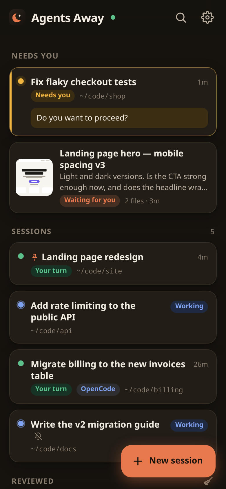</td>
    <td width="33%">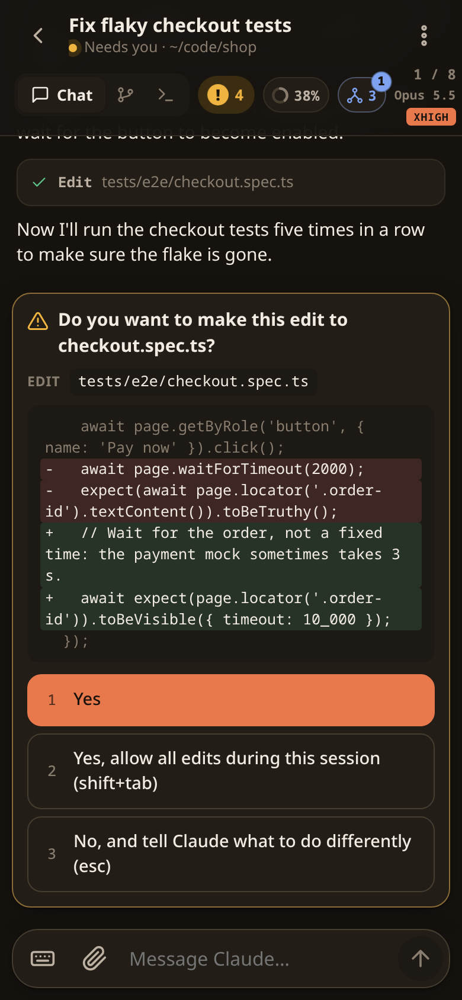</td>
    <td width="33%">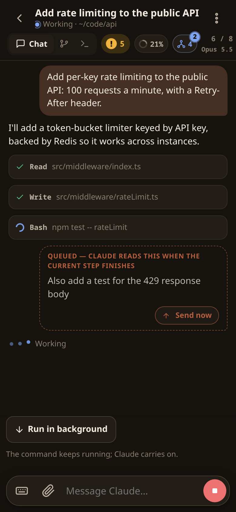</td>
  </tr>
  <tr>
    <td width="33%">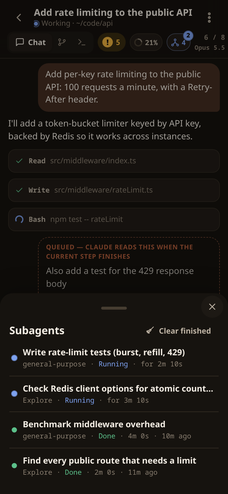</td>
    <td width="33%">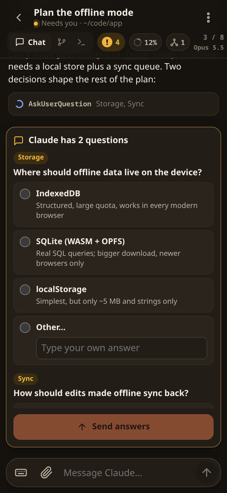</td>
    <td width="33%">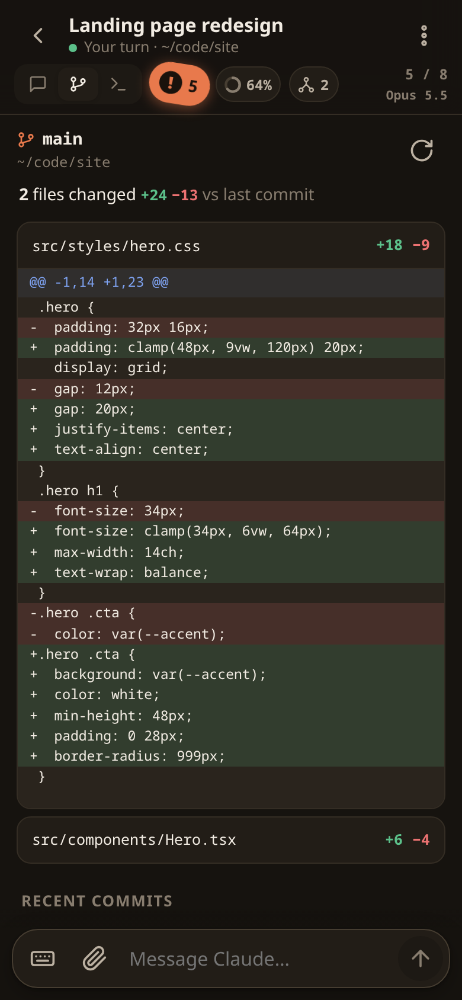</td>
  </tr>
  <tr>
    <td width="33%">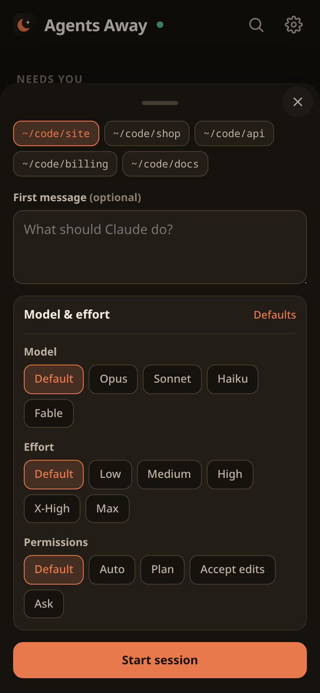</td>
    <td width="33%">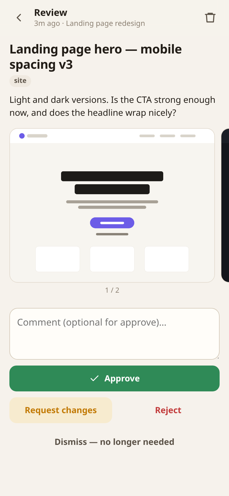</td>
    <td width="33%">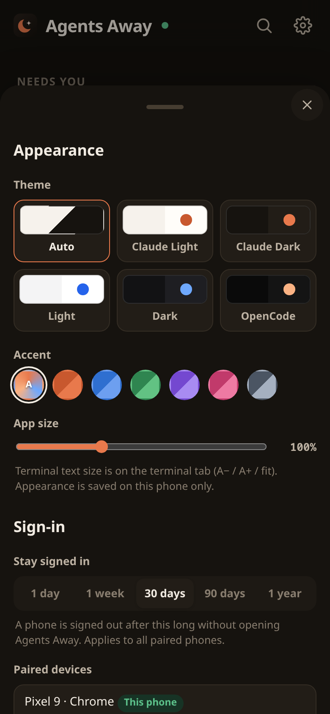</td>
  </tr>
</table>
<p align="center"><sub>Screenshots use made-up demo data (<code>tools/demo/server.ts</code>).</sub></p>

> [!WARNING]
> **Agents Away is meant for a trusted private network: your home LAN or your own VPN. Securing that
> network is up to you.**
> Anyone with a paired phone (or a fresh pairing link) can read your sessions, type into them and
> approve the commands Claude wants to run, which amounts to running code on your PC. Access is
> guarded by pairing: one-time links, plus per-device sign-ins that expire. There are no user
> accounts, no passwords, no rate limiting and no audit log, and the code hasn't had a security review. **Never expose its ports to the internet**
> (no port forwarding, no public reverse proxy). To use it away from home, connect your phone to
> your network with a VPN such as WireGuard or Tailscale. See [Security](#security).

## Features

- **Sessions list:** status (working / needs you / your turn), pin, mute, rename. Swipe a card left to
  end that session; swipe inside a session to move between sessions.
- **Chat:** the live transcript with tool calls, images and queued messages, plus a "while you were
  away" summary of what happened since you last looked.
- **Reply** with text, photos or files. Answer menus and permission prompts with one tap. Includes a
  command palette for slash commands and your own quick replies.
- **Claude's questions** (AskUserQuestion) as a card: every question with its options and
  descriptions, single or multiple choice, plus "Other…" to type your own answer. Sent with one tap.
- **Context and subagents:** the session header shows how full the context window is and the
  subagents it spawned (live running count); open one to read its own chat.
- **Terminal:** a live view of the session's terminal, with key buttons (Esc, arrows, Ctrl-C…).
- **Changes:** `git diff` of the session's repo.
- **Notifications** when a session needs permission, asks you a question ("Claude is asking: …") or
  finishes, with **Allow** right in the notification. They stay quiet while you're typing at the PC.
- **Image reviews:** Claude runs `agents-away review shot.png` and you get the image on your phone with
  Approve / Request changes / Reject, plus a comment. The answer goes back to Claude.
- **Start, resume and end sessions** from the phone, choosing model, effort and permission mode.
- **Search** across all past Claude Code transcripts.
- **OpenCode** sessions too (optional), through OpenCode's own server API.
- **Themes:** Warm Light and Warm Dark, neutral Light and Dark, and Black (near-black, OpenCode-style);
  Auto follows the phone. Accent colours and text size too.
- **Languages:** English, Spanish and Brazilian Portuguese. It follows the phone's language, or pick one
  in ⚙ → Appearance. Notifications and the CLI are in English.

## Requirements

- Linux with a systemd user session (Arch, Debian/Ubuntu, Fedora… tested on Arch).
- [Bun](https://bun.sh) ≥ 1.1, `tmux` ≥ 3.2, `openssl`.
- [Claude Code](https://docs.claude.com/en/docs/claude-code) (`claude` on your PATH).
- Optional: `ripgrep` (search), `qrencode` (QR codes when pairing), OpenCode.
- A phone on the same network as the PC, or connected to it over a VPN. Android/Chrome works best;
  iOS needs the app added to the Home Screen before it can receive notifications (iOS 16.4+).

## Compatibility

Agents Away reads Claude Code's local files (session status files, transcripts, subagent folders) and its
terminal screen, none of which are a documented API. A Claude Code update can change them and break a
feature without warning, so here is exactly what it has been tested with:

| | Tested | Notes |
|---|---|---|
| Claude Code | 2.1.329 | Newer versions usually work; if something breaks after an update, open an issue with the version |
| OpenCode | 2.3.2 | Optional; uses OpenCode's own server API |
| OS | Arch Linux (kernel 7.3) | Any Linux with a systemd user session should work; macOS/Windows aren't supported |
| Bun / tmux | 1.4.4 / 3.8 | Bun ≥ 1.1 and tmux ≥ 3.2 required |
| Shell | fish 4.9 | The bash/zsh wrapper is included but has had less real-world use |
| Phone | Android, Chrome | iPhone (Safari, iOS 16.4+) and Firefox are untested |

Known limits: the context-window size is inferred from the model name (Claude Code doesn't write it to
disk); a subagent's "running" state is an estimate from its files.

## Install

```bash
git clone <this repo> ~/agents.away && cd ~/agents.away
./install.sh
agents-away pair
```

`install.sh` is safe to re-run (that's also how you update). It:

1. installs the npm dependencies with `bun install`;
2. creates a private certificate authority and an HTTPS certificate for this PC's addresses
   (`~/.config/agents-away/certs`);
3. links the `agents-away` command into `~/.local/bin`, plus the short alias `aa` if that name is free;
4. adds Agents Away's hooks to `~/.claude/settings.json`, keeping a backup and leaving your other hooks alone;
5. installs the `agents-away-review` skill (`agents-away skill install`), so Claude Code and OpenCode know how to send you images;
6. installs a small `claude` wrapper for your shell (fish, bash or zsh) that starts interactive
   sessions inside a dedicated tmux server, so Agents Away can type into them (more on this below);
7. installs and starts the `agents-away` systemd user service.

Options: `./install.sh --no-shell` skips the wrapper; `./install.sh --uninstall` removes everything
except your config and data.

### Firewall

If the PC runs a firewall, allow TCP **7443** (the app) and **7440** (the setup page) from your
LAN/VPN only. For example, with ufw:

```bash
sudo ufw allow from 192.168.0.0/16 to any port 7440,7443 proto tcp
sudo ufw allow in on wg0 to any port 7440,7443 proto tcp   # if you use WireGuard
```

Don't expose these ports to the internet. A signed-in phone controls your sessions.

### Pair your phone

`agents-away pair` prints two QR codes (or links, without `qrencode`):

1. **Setup page** (`http://<pc-ip>:7440`): download and install the Agents Away CA certificate.
   Android: *Settings → Security → Encryption & credentials → Install a certificate → CA certificate.*
   iOS: install the profile, then enable it under *Settings → General → About → Certificate Trust Settings*.
2. **Pairing link** (`https://<pc-ip>:7443/pair?t=…`): signs this phone in. Each link works **once,
   within 10 minutes**; run `agents-away pair` again for another phone or address. Then use the browser's
   **Install app / Add to Home Screen** and turn on notifications in the app.

The phone stays signed in as long as you keep using it. After **30 days without opening Agents Away** it's
signed out and needs a new pairing link. Change that period (1 day to 1 year) and see or remove
signed-in devices in the app under **⚙ → Sign-in**.

The CA is generated on your PC and only ever signs Agents Away's certificate. It is name-constrained to
private IP ranges and your PC's own names, so even a leaked CA key can't impersonate other websites to
your phone. When installing it, compare the SHA-256 fingerprint the phone shows with the one
`agents-away pair` prints. If your PC's IP changes, run `bin/agents-away-certs && systemctl --user
restart agents-away`; the phone keeps the same CA. Installs from before 0.1.0 have a CA without name
constraints: `bin/agents-away-certs --new-ca`, restart, then replace the CA on the phone.

## Using it

**Sessions must run inside Agents Away's tmux** for the phone to type into them. After installing, just
run `claude` in a new terminal as usual: the wrapper opens it inside the `agents-away` tmux server
(separate from your own tmux, which stays untouched). It looks and behaves the same.

- Sessions started some other way still show up in the app, but read-only.
- Reattach to a session from the PC with `agents-away attach` (or `agents-away a`), which shows a picker.
  Sessions you start from the phone are attached the same way.
- Bypass the wrapper once with `command claude …` or `AWAY_NO_TMUX=1 claude`.
- Already inside tmux? The wrapper steps aside and the session works normally, but read-only.

While Claude Code runs a long command or a subagent, a **Run in background** button appears (the same
as pressing Ctrl+B at the PC): the command keeps running and Claude carries on with the next step.

### Approving from the phone

Permission prompts show exactly what you're approving: a plan as formatted markdown (summary, steps,
open questions), a command with its description, an edit as a diff, a new file's content, a web fetch's
URL. The session list and the notification say it in one line ("Plan ready: …", "Run: npm test"). For
Claude Code this comes from its `PreToolUse` hook; if you installed the hooks before 0.1.0, run
`agents-away hooks install` again (`agents-away hooks status` tells you). OpenCode needs no hooks: its
server API says which tool call a permission request is for.

<table>
  <tr>
    <td width="33%">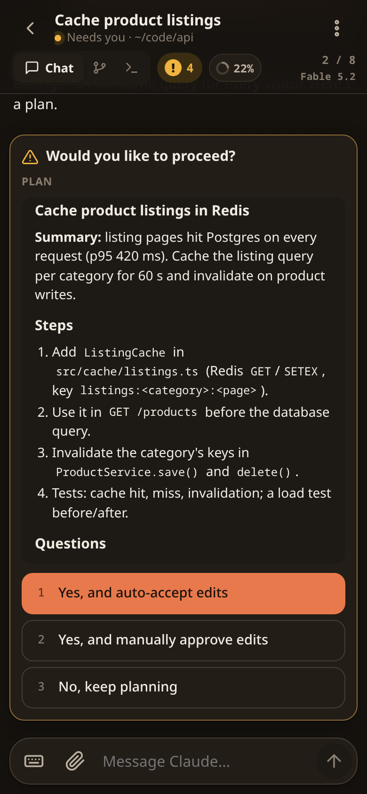</td>
    <td width="33%"></td>
    <td width="33%"></td>
  </tr>
</table>

### Image reviews

Claude Code and OpenCode use this automatically through the `agents-away-review` skill when you ask them to ("send me the
render on my phone"). You can also run it yourself:

```bash
agents-away review -t "Login page v2" -m "Is the spacing better?" shot1.png shot2.png
# blocks until you answer on the phone (up to 9 min), then prints APPROVED / CHANGES REQUESTED / REJECTED + comment
agents-away review --async …          # don't wait; the answer is typed into the session later
agents-away review --list             # open reviews from this session
agents-away review --withdraw <id>    # take back a review that's no longer relevant
agents-away notify "Title" "Body"     # a plain push
```

### OpenCode (optional)

If [OpenCode](https://opencode.ai) is installed, its sessions appear in the app whenever its
background server is running (`opencode service start`, or just use OpenCode). You can read, reply,
interrupt, answer permission requests and question forms (or dismiss them), see the context-window
% and subagents (child sessions, read-only), read thinking models' reasoning (collapsed "Thinking"
blocks), and start new OpenCode sessions with a model, variant
and agent of your choice (it defaults to the model you used last; recent models are one tap). The
Terminal tab shows the session's own OpenCode terminal (or opens one) and the composer types into
it there. Not yet supported: search.

<table>
  <tr>
    <td width="33%">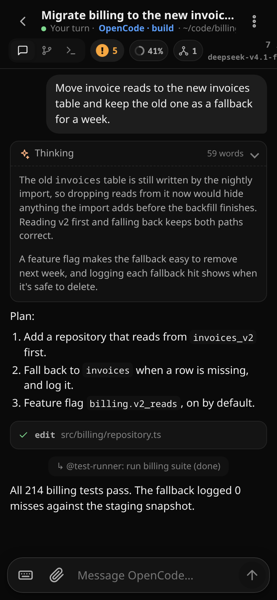</td>
    <td width="33%">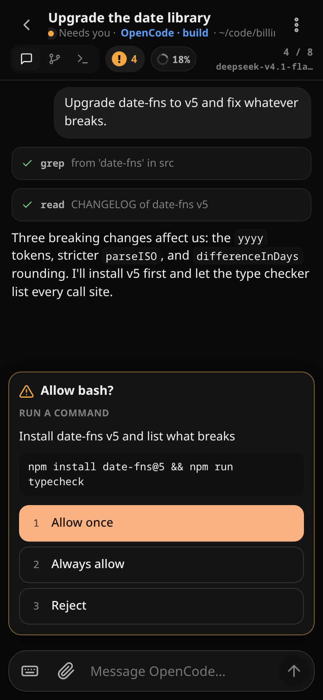</td>
    <td width="33%">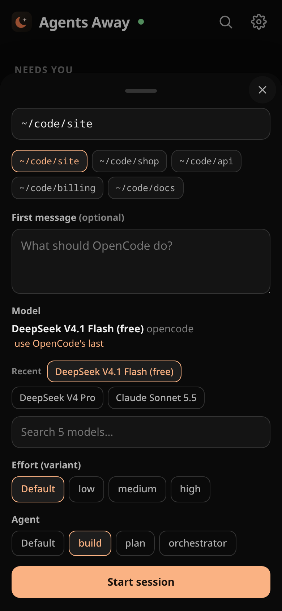</td>
  </tr>
</table>

## Commands

| Command | |
|---|---|
| `agents-away pair` | Pairing QR codes / links for a new phone |
| `agents-away status` | Server status and current sessions |
| `agents-away attach` / `agents-away a` | Attach this terminal to a Agents Away tmux session |
| `agents-away review …` / `agents-away notify …` | See above |
| `agents-away hooks install\|uninstall\|status` | Manage the Claude Code hooks |
| `agents-away skill install\|uninstall\|status [--claude\|--opencode]` | The `agents-away-review` skill for Claude Code and OpenCode |
| `systemctl --user restart agents-away` | Restart the server (the app reloads itself) |
| `journalctl --user -u agents-away -f` | Server logs |

## Configuration

Settings like quiet-while-at-PC and which events notify you are in the app (⚙). Everything else:

| Variable | Default | |
|---|---|---|
| `AWAY_PORT` | `7443` | HTTPS app + WebSocket (all interfaces) |
| `AWAY_ONBOARD_PORT` | `7440` | Plain-HTTP setup page / CA download (all interfaces) |
| `AWAY_LOCAL_PORT` | `7442` | Local API for hooks and the CLI (127.0.0.1 only) |
| `AWAY_CONFIG_DIR` | `~/.config/agents-away` | Secrets: local API token, push keys, certificates, device sign-ins, tmux.conf |
| `AWAY_DATA_DIR` | `~/.local/share/agents-away` | Reviews, uploads, image cache, per-session prefs |
| `AWAY_SHELL` | your login shell | Shell used to launch sessions started from the phone |
| `AWAY_EXTRA_SOCKETS` | none | Extra tmux servers to watch, comma-separated (`tmux -L <name>`), e.g. sessions from an older setup |

Set these in the service with `systemctl --user edit agents-away`, adding `Environment=…` lines.

## Security

Agents Away assumes the network between your phone and your PC is private and trusted (see the warning
at the top). Within that assumption:

- **Pairing links are one-time codes.** `agents-away pair` asks the server for a fresh code that works once
  and expires after 10 minutes. A link that leaks later is useless.
- **Each phone gets its own sign-in:** a random 256-bit session in an HTTP-only, Secure cookie. The
  server stores only a hash of it (`~/.config/agents-away/devices.json`). A sign-in expires after the
  "Stay signed in" period without use (default 30 days) and is renewed whenever the app connects.
- **Lost a phone?** In the app, go to **⚙ → Sign-in → Paired devices** and remove it, or tap
  **Sign out all other devices**. It's cut off immediately. Without the app at hand, delete
  `~/.config/agents-away/devices.json` and restart Agents Away to sign out every phone.
- Treat a signed-in phone like a terminal on your PC: it can type into your sessions and approve
  commands.
- The local API used by hooks and the CLI listens on 127.0.0.1 only and needs the local token from
  `~/.config/agents-away/config.json`, which never leaves the PC.
- Keep `~/.config/agents-away` private. It holds the local token, the push keys, device sign-ins and the
  CA's private key.
- The setup page on port 7440 is plain HTTP and serves only the public CA certificate and
  instructions.
- What's **not** covered: exposure to the internet, untrusted devices on your LAN that obtain the
  pairing link within its 10 minutes, and anyone with access to your PC user account.
  If your LAN isn't trustworthy (shared flat, office, public Wi-Fi), reach Agents Away over a VPN only
  and restrict the ports to the VPN interface in your firewall.

## How it works

Claude Code writes a small status file per running session (`~/.claude/sessions/<pid>.json`) and a
transcript (`~/.claude/projects/…/<session>.jsonl`). Agents Away reads both, matches each session to its
tmux pane through the process's terminal, and:

- **Chat view:** tails the transcript.
- **Terminal view:** `tmux capture-pane`.
- **Replies:** bracketed-paste into the pane. Menu answers move the ❯ cursor with arrow keys after
  checking the menu is still on screen. Question forms are filled in the same way (arrows, Space,
  typing into "Type something"), re-reading the screen after every step.
- **Notifications:** Claude Code hooks (`agents-away hook`) report "needs permission" and "finished" to
  the server, which sends Web Push.

See [AGENTS.md](AGENTS.md) for the code layout.

## Uninstall

```bash
./install.sh --uninstall
rm -rf ~/.config/agents-away ~/.local/share/agents-away   # optional: config, certificates, reviews
```

Also remove the Agents Away CA from your phone's trusted certificates.

## Terms of use

Agents Away is a remote control for **your own** sessions. It runs the official, unmodified `claude`
program you signed in to yourself, in a terminal on your PC, and relays what you type and tap on your
phone. It never reads, stores or uses your Claude login or tokens, never calls Anthropic's API, and
doesn't proxy, share or resell access. To stay within
[Anthropic's terms](https://code.claude.com/docs/en/legal-and-compliance) and
[Usage Policy](https://www.anthropic.com/legal/aup):

- **Your account, your devices.** Pair only your own phone. Don't give anyone else a pairing link or
  access to the app: that would be sharing your account, which Anthropic's Consumer Terms don't allow.
- **You stay in the loop.** Everything Claude receives is something you typed or tapped. Agents Away has
  no auto-approve or auto-reply, and forks shouldn't add unattended automation that drives a
  subscription session (the Consumer Terms restrict automated access except via an API key).
- Normal usage limits apply: work done from the phone counts against your plan like any other.

This is a summary, not legal advice; the linked terms are what count.

Agents Away is an independent open-source project, not affiliated with or endorsed by Anthropic or
OpenCode. Claude and Claude Code are trademarks of Anthropic, PBC; OpenCode is a project of its
respective owners. They're named here only to say what Agents Away works with.

## Changelog

See [CHANGELOG.md](CHANGELOG.md).

## License

[MIT](LICENSE): free to use, fork and modify.
